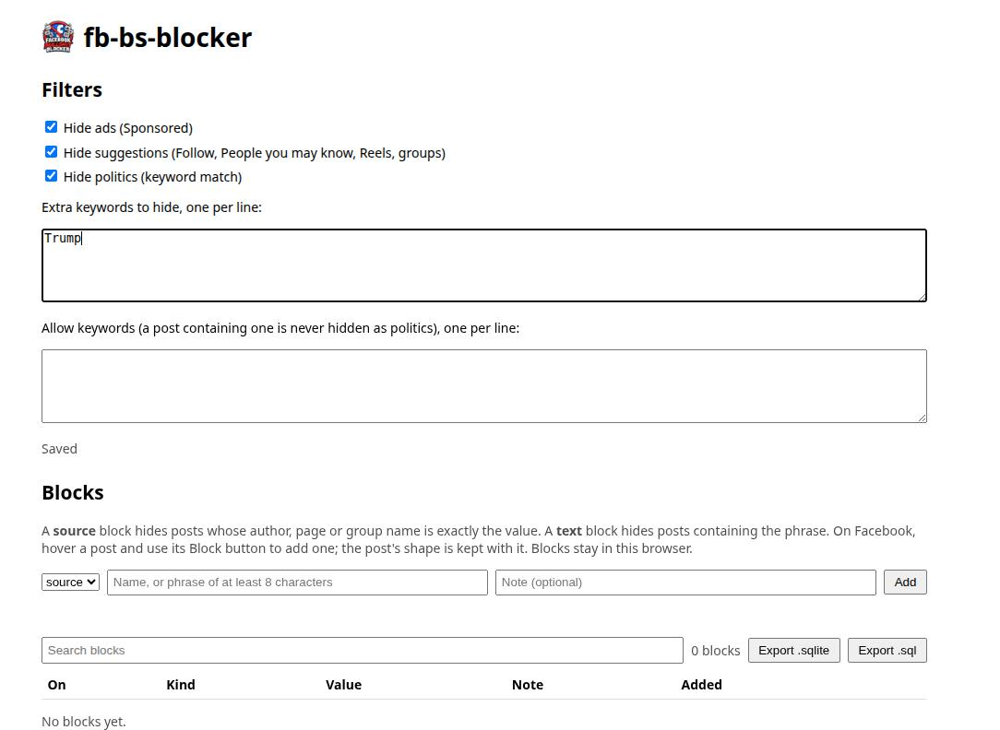

<p align="center"></p>

# fb-bs-blocker

A browser extension that hides posts in the facebook.com feed that are ads, suggestions
(posts with a Follow button, groups you have not joined, Reels), match a political keyword
list, or are ones you blocked yourself. Manifest V3; Chrome and Firefox. BSD 2-Clause.

Ads and suggestions are identified from Facebook's own feed data, not from the label on the
page, so a relabelled or scrambled "Sponsored" does not get past it. Responses are read in
the browser and nothing leaves it. Not affiliated with or endorsed by Meta.

## Contents

- [Install](#install)
- [Using it](#using-it)
- [The options page](#the-options-page)
- [Blocking a post or a source](#blocking-a-post-or-a-source)
- [Exporting your blocks](#exporting-your-blocks)
- [Finding out why a post is hidden](#finding-out-why-a-post-is-hidden)
- [Troubleshooting](#troubleshooting)
- [Privacy and where data is kept](#privacy-and-where-data-is-kept)
- [Status](#status), [Methods](#methods), [Limits](#limits), [Layout](#layout), [License](#license)

## Install

There is no store listing. Load it from a copy of this repository.

**Chrome (and other Chromium browsers)**

1. Get the files: `git clone https://github.com/nestorwheelock/fb-bs-blocker`, or download the
   repository as a zip from GitHub and unpack it.
2. Open `chrome://extensions`.
3. Turn on **Developer mode** (top right).
4. Click **Load unpacked** and choose the directory that holds `manifest.json`.
5. Open or reload a facebook.com tab. The extension only acts on pages loaded after it was
   installed or reloaded.

Chrome lists a warning on the extension's card, `'background.scripts' requires manifest
version of 2 or lower`. It comes from the `scripts` entry that Firefox needs and is harmless
in Chrome.

**Updating.** Pull or download the new files, click the circular reload arrow on the
extension's card in `chrome://extensions`, then reload the Facebook tab. Skipping the tab
reload leaves the old script running in it; the console then shows `Extension context
invalidated` until you reload the tab.

**Firefox.** The manifest declares an add-on id and a Firefox background script, but Firefox
has not been tried. `about:debugging`, This Firefox, Load Temporary Add-on, choose
`manifest.json`.

## Using it

With the defaults, nothing needs setting up. Scroll the feed:

- **Ads** are hidden, in the feed and in the right column, including the "Sponsored" heading
  above the right-column cards.
- **Suggestions** are hidden: posts whose header shows a Follow button, posts from groups you
  have not joined (the Join button), Reels rows, "People you may know", and similar.
- **Politics**: a post that contains a word from the built-in keyword list is hidden. You can
  add words and exempt words on the options page. Your own posts are never hidden as politics.
- **Blocks**: anything you blocked by hand is hidden. See below.

Hidden posts are removed from the page with `display: none`, not deleted. Switching a filter
off on the options page shows them again within a moment; no reload is needed.

## The options page

Open it from `chrome://extensions` (Details, Extension options), or click the extension's
toolbar button.



**Filters** (the top half)

- Three switches: hide ads, hide suggestions, hide politics. Each is saved when you change it
  ("Saved" appears under the boxes).
- *Extra keywords to hide*: one word or phrase per line. A post containing one as a whole word
  is hidden under politics. "election" does not match "selection".
- *Allow keywords*: one per line. A post containing one is never hidden as politics, however
  many hide-words it also has.
- These settings are in `chrome.storage.sync`, so they follow your browser profile if sync is on.

**Blocks** (the bottom half) is described next.

## Blocking a post or a source

There are two kinds of block:

| kind | hides a post when | needs |
|---|---|---|
| **source** | one of the post's first eight text lines is exactly the value: the author, page or group name | 2 or more characters |
| **text** | the post's text contains the value anywhere | 8 or more characters |

Both ignore capital letters and extra spaces. A source block is the whole name, not part of
it: blocking "Sam Lee" does not hide "Sam Leeds", and does not hide a post that only mentions
Sam Lee in its body. A block applies to every post, yours included. It is always on; it does
not depend on the filter switches.

**From Facebook.** Point at a post. A red **Block** button appears at the post's top right,
to the left of Facebook's own "..." and close buttons. Click it for the menu:

- **Block this post** stores the first line of the post's own words (the first line after the
  author that is at least 25 characters and is not a "3 hours ago" line), shortened to 40
  characters, as a text block. The item is greyed out when the post has no such line, for
  example a photo with a short caption.
- **Block source: NAME** stores the author, page or group name as a source block. It is greyed
  out if the name is missing or longer than 80 characters.

The post disappears at once. Every block also stores the post's **shape**: its first twelve
text lines, its author, the page path, its size, why it was already hidden if it was, and a
short hash of its element structure (tag names and nesting, no class names, no text). Open
**Details** on a block to read it. The shape is there so you can see later why a block matched
and compare posts; it does not affect matching.

**From the options page.** Under Blocks, choose the kind, type the value, add an optional
note, click **Add**. An exact duplicate (same kind, same value) is refused with "Already
blocked."

**Managing blocks.** Each row has:

- **On** checkbox: switch the block off without losing it; the post comes back.
- **Details**: the stored shape and the date it was last changed.
- **Edit**: change the kind, value and note in place, then Save or Cancel. The same length
  rules apply, and the error shows under the Add form.
- **Delete**: asks you to confirm, then removes it and the post returns.

The **Search blocks** box filters the list by value, note or kind. The count beside it says how
many are shown. A block added from a Facebook tab appears in an open options page by itself.

## Exporting your blocks

Two buttons above the list:

- **Export .sqlite** builds a real SQLite 3 database file in the browser and saves it as
  `fb-bs-blocker-YYYY-MM-DD.sqlite` through your browser's download.
- **Export .sql** saves the same data as SQL text, `fb-bs-blocker-YYYY-MM-DD.sql`. Rebuild a
  database from it with `sqlite3 blocks.sqlite < fb-bs-blocker-YYYY-MM-DD.sql`.

The table:

```sql
CREATE TABLE blocks (
  id         INTEGER PRIMARY KEY,
  kind       TEXT    NOT NULL CHECK (kind IN ('source', 'text')),
  value      TEXT    NOT NULL,
  note       TEXT    NOT NULL DEFAULT '',
  enabled    INTEGER NOT NULL DEFAULT 1,
  created_at TEXT    NOT NULL,   -- ISO 8601, UTC
  updated_at TEXT    NOT NULL,
  page       TEXT,               -- path of the Facebook page it was blocked from
  shape_json TEXT                -- the stored shape, as JSON
);
```

Some queries, with the `sqlite3` command-line tool:

```sh
sqlite3 -header fb-bs-blocker-2026-10-28.sqlite \
  "select id, kind, value, enabled from blocks order by created_at"

# which authors were blocked, with how long their first line was
sqlite3 fb-bs-blocker-2026-10-28.sqlite \
  "select json_extract(shape_json, '$.author'), json_extract(shape_json, '$.rect.h') from blocks"
```

There is no import: an export is a backup and a way to look at your data, not a way to load
blocks into another browser. To move blocks, add them again on the options page.

## Finding out why a post is hidden

Open DevTools (F12), Console, on the Facebook tab. Two kinds of line begin `[fbf]`:

- one summary line when the counts change: version, feed posts found, ad keys, right-column
  keys, suggestion keys, posts hidden, and whether your name was found
- one line per hide: the reason, what matched, and the first lines of the post. For a block the
  reason is `blocked` and the detail is the kind and id, for example `source #3`; the id is the
  `id` column of the export and the number in the block's row.

A block made from the button also logs `[fbf] blocked <kind> #<id> <value>`.

The second kind of line is how to find out why a post is missing.

## Troubleshooting

| what you see | what to do |
|---|---|
| Nothing is hidden at all | Reload the Facebook tab. Check the extension is on in `chrome://extensions`. Look for `[fbf]` lines in the Console. |
| `Extension context invalidated` in the Console | You reloaded the extension and not the tab. Reload the tab. |
| No Block button over a post | Reload the tab. The button attaches to feed posts; it does not appear over stories, the composer or the right column. |
| A post you wanted is hidden | Find its `[fbf] hide` line. `blocked`: switch the block off or delete it. `politics`: add an allow keyword, or remove the extra keyword. `suggestion`: the post has a Follow or Join button; switch suggestions off. `ad`: Facebook's data marked it as one. |
| An ad or suggestion is still showing | It may have no text in the data fields the extension reads (see Limits). Block it by hand with the Block button. |
| "Block this post" is greyed out | The post has no line of its own words of 25 characters or more. Use "Block source", or add a text block by hand with a phrase from it. |
| `.sqlite` export says "Export failed" | The message under the Add form says why. Use **Export .sql** instead; it needs no extra code. |
| A block shows on the options page but the post is still there | The post must contain the exact name (source) or phrase (text). Open Details to see what was stored, and compare it to the post's text. |

## Privacy and where data is kept

- The extension makes no network requests of its own. It reads Facebook's responses in your
  browser, in a copy, and keeps keys in memory only.
- Filter settings are in `chrome.storage.sync` (synced by your browser if you use browser sync).
- Blocks are in IndexedDB under the extension's own origin (database `fbf-blocks`), on this
  browser only; they are not synced. A copy of `{id, kind, value, enabled}` for each block is
  placed in `chrome.storage.local` under `fbf-rules`, which is what the page script reads.
- Removing the extension, or clearing its site data, deletes your blocks. Export first if you
  want to keep them.
- Permissions: `storage` and two Facebook hosts. No `tabs`, `scripting` or `webRequest`.

## Status

Version 0.5.0. Developed against captured Facebook traffic and tested offline
(`node --test test/*.test.js`). Behavior in a live browser is reported by the person using it,
and Facebook changes its markup and data without notice. Expect to adjust `selectors.js` and
`adscan.js`. What has and has not been seen on the live page is listed under Limits.

## Methods

The extension went through two approaches. The first was replaced because of what was
observed on the live page, not because of an assumption.

### 1. Classify the rendered text

A pure function (`classify.js`) takes the text lines and link targets of one feed post and
returns hide or keep, with a reason:

- ads: a line equal to "Sponsored", "Ad", "Paid partnership" or "Promoted", or a link to
  `/ads/about`
- suggestions: lines such as "Suggested for you", "People you may know", "Follow", "Join",
  "Reels", "Because you follow ..."
- politics: whole-word keyword match against a default list plus the user's own, with an
  allow list that exempts a post

Whole-word matching keeps "election" from hiding "selection". Each rule has a test.

### 2. Find the feed posts in the page

A selector registry (`selectors.js`) tries ordered fallbacks and uses the first that matches.
On the page this was developed against, `[role="feed"]` was absent and the feed posts carried
`aria-posinset`, so that is first in the list. A post is re-evaluated only when its text
length changes, and hidden posts get a data attribute that one CSS rule turns into
`display: none`. This keeps the observer from looping on a page that re-renders constantly.

### 3. Why the rendered text was not enough

Three observations, from the live page and its console:

- The ad label was "Ad" on the page tested, not "Sponsored", so a fixed list of labels
  goes stale.
- The text of a feed post began with eight lines of the word "Facebook" before any real
  content. Reading text from the rendered tree is unreliable there, and a deliberately
  scrambled label cannot be read at all.
- Ads in the right column are not feed posts, so no feed selector reaches them.

### 4. Read Facebook's own data

The page is built from JSON that Facebook sends it. The ads are marked there, regardless of
how they are drawn.

**Capture.** DevTools, Network tab, Preserve log on, reload, scroll, then "Save all as HAR
with content". Two ways this failed: leftover text in the Network filter box hid every
request (the status bar read "0 / 846 requests") and produced an empty export, and exporting
before the page was scrolled left out the feed pagination requests. A HAR holds your session
cookies and tokens. Do not share or commit one.

**Analysis.** Offline, with small Node scripts, never by eye. The bodies needed handling
first: most were absent from the export, and the main page response was base64. Feed
pagination responses are newline-delimited JSON. The method was to find a marker, then
cross-tabulate it against the others, then check it separately on posts that should not have
it.

**Markers found**, each confirmed against the others on real responses:

| marker | where | means |
|---|---|---|
| `tracking` string that parses to `is_sponsored: 1` | inside a feed story | ad |
| non-null `th_dat_spo` | on the feed post object | ad |
| non-null `sponsored_data` | right-column ad object, beside a nested `rhc_ad` | ad |
| `viewer_forum_join_state: "CAN_JOIN"` | inside a feed story | post from a group the viewer has not joined |
| `follow_location: "IFR_POST_IN_NEWS_FEED"` | story action links, with `subscribe_status: "CAN_SUBSCRIBE"` | post whose header shows a Follow button |
| `comment_composer_placeholder: "Comment as <name>"` | every post | the viewer's own name |

`th_dat_spo` was non-null on 11 of 11 ads and 0 of 19 organic posts in one capture, and it
holds when `tracking` is missing, so both are checked. In a later capture the Follow marker
was on 19 of 108 feed posts and on none of the ads or group posts among them.

**Post boundary.** A feed post is the `node` under `news_feed.edges[]`, or a streamed
`data.node`. The text of an ad is read from that one post only, never from neighbouring
bytes. An early version took a window of text around the marker and would have swept in the
post beside it.

**Which text.** Matching needs text the page also displays. Reading every string in a post
produced keys such as "Comment as <viewer>", CSS class lists, and a group's privacy blurb.
All of those appear on organic posts, so keying on them would hide the whole feed. The
extractor reads only named fields: `message.text`, `title_with_entities.text`,
`description.text`, `title`, `description`, `link_title`, `link_description`. For group and
Follow suggestions only `message.text`, because a group's description is shared by every post
from that group. One video ad had no message text and was missed until `link_title` and
`link_description` were added.

**Right-column cards.** A card displays only a title and a domain; its description is in the
data but never drawn. The fields sit in a nested `rhc_ad` next to `sponsored_data`. The key is
the title and the domain together, and a card must show both. A title alone could be a word
("Claude") that appears elsewhere.

### 5. Deliver it in the page

- `hook_main.js` runs in the page's own world at `document_start` and wraps `fetch` and
  `XMLHttpRequest` for GraphQL requests. It reads each response from a clone, so the page's
  copy is untouched, runs the extractor, and posts the keys to the content script.
- The first screen of the feed is not fetched; it is embedded in the page as JSON. The
  content script scans those inline `application/json` scripts with the same extractor.
- A key is the first 40 characters of an ad's or suggestion's text, lowercased with
  whitespace collapsed and trimmed. A feed post whose visible text contains a key is hidden.
  Keys that arrive after the post is drawn cause every post to be checked again.
- Right-column ads: the link card whose text matches a title and domain is hidden, then the
  "Sponsored" heading above it.
- The viewer's own posts are exempt from the politics rule. Their name is found in the first
  eight lines of a post after the decoy "Facebook" lines are dropped.

Why two worlds: wrapping `fetch` has to happen in the page's world, and reaching extension
storage has to happen in the isolated one.

### 6. Problems found by running it, and what each was

Each of these came from the console on the live page, not from reading the code.

- **"Extension context invalidated".** Reloading the extension leaves the old script running
  in the open tab with no connection to it. The script now stops itself when its extension
  context is gone.
- **Posts flickering on and off.** A hidden element is not rendered, so its `innerText` has no
  line breaks. The label rules read whole lines, so on the next check a hidden "Follow" or
  "Ad" post no longer matched, was shown, and was hidden again. The check now lifts the hide
  attribute, reads the text as rendered, and restores it in the same task, so nothing is
  painted in between. Separately, Facebook empties posts that scroll out of view and refills
  them; a post with under 40 characters of text is left as it is instead of being un-hidden.
  The delay before hiding is one animation frame, and the page-wide scans run at most once a
  second.
- **The author's own post hidden as politics.** The post about this extension said "political".
  An exemption for the viewer's own posts looked at the first eight lines, but those eight are
  decoys, so the name was never found. The decoys are now dropped first. Each hide is also
  logged with its reason now, which is how this was found.
- **A right-column card not hidden.** The only ad key from the data was a description that is
  never displayed, and the displayed titles were shorter than the 20-character minimum for
  keys. Keying on title and domain fixed the design; the first version of that code and its
  test both put the fields on the wrong object, and it was running the extractor against the
  real response that showed it. Test fixtures should be copied from the real shape.
- **The Block button covered Facebook's "..." menu.** The first placement put the button at the
  post's top right corner, over the post's own menu, and under Facebook's fixed top bar when
  the post's top had scrolled off. It now sits left of those buttons and stays below the bar.

### 7. Validation

Run against captured responses with the real extractor, counting by feed post:

| capture | feed posts | ads | ads keyed | join posts | join keyed | Follow posts | Follow keyed | organic keyed |
|---|---|---|---|---|---|---|---|---|
| first | 30 | 11 | 10, then 11 after adding link fields | | | | | 0 of 19 |
| second | 50 | 5 | 5 | 8 | 8 | | | 0 |
| third | 108 | 25 | 25 | 9 | 9 | 19 | 19 | 0 |

In the first capture, 10 of the 11 ads were keyed before `link_title` was added, which is how
the missing field was found. From the third capture the extractor produced six right-column
keys, and the text of one card from a screenshot matched its key.

### 8. Blocks and how they are stored

Hand-made blocks are separate from the data-driven filters: they match on the post's rendered
text, so they work on anything you can see.

- A content script that touches IndexedDB gets the *page's* database, not the extension's. So
  the store lives where the extension's own origin is: the background service worker and the
  options page share it. The Block button sends its request to the worker (which accepts
  messages from this extension only), and after every change the worker copies the minimum a
  page script needs into `chrome.storage.local`, where `content.js` reads it and listens for
  changes.
- A `.sqlite` file is made in the browser by loading the block list, as SQL text produced by
  `export.js`, into the vendored sqlite-wasm and exporting the database's bytes. The same SQL
  text is what "Export .sql" saves. Extension pages therefore carry the content security policy
  `script-src 'self' 'wasm-unsafe-eval'`, which WebAssembly needs; the policy does not apply to
  Facebook pages.
- sqlite-wasm is `@sqlite.org/sqlite-wasm` 3.54.1 (Apache-2.0), copied into `vendor/sqlite-wasm/`
  with its license and a `NOTICE.md`. It is loaded only when you click Export .sqlite.
- Tests cover validation, matching, edits, and the SQL: the generated SQL is loaded into the real
  `sqlite3` command-line tool, including a value with a quote and a value that looks like SQL.
  A database exported by the wasm build was also read back with `sqlite3` and passed
  `PRAGMA integrity_check`.

### 9. Tests

`node --test test/*.test.js`. Fixtures are synthetic and written to match the structure
found, so no captured traffic is committed. They cover: only the ad's own post contributes
keys; UI placeholders never become keys; newline-delimited, partial and `for (;;);`-prefixed
bodies; the right-column card; a video ad with no message; a joinable group post versus a
member's; the Follow marker; the viewer's name, including the longer of two forms; finding the
viewer past the decoy lines; text normalization; the block rules and the SQL export (the SQL
tests are skipped if no `sqlite3` is on the path).

## Limits

- A suggestion or ad whose entry has no text in the fields above produces no key and is not
  hidden by data. The label rules in `classify.js` may still catch it, and you can block it by
  hand.
- Matching is on text. If Facebook changes punctuation between its data and its display, a
  key will not match.
- Any post whose header shows a Follow button is hidden under suggestions, including a post
  from a page you meant to look at.
- Politics is a keyword list: it will miss posts that do not use the words and hide posts
  that do (a comment quoting a word hides its post). Your own posts are exempt from it, and
  from nothing else.
- A source block matches a name on one of a post's first eight lines. A post that shows the name
  further down, or in a different form (a nickname, a page that renamed), is not matched.
- Blocks are not synced between browsers and cannot be imported (see Exporting your blocks).
- Seen working on the live page: ads hidden from feed data, a Reels row and a group "Join"
  row hidden by label, one hide logged per post, the viewer's name found; in 0.5.0, the Block
  button and its menu over a post, a source block hiding the post and appearing in the options
  page, Delete, and a `.sqlite` export that opens in `sqlite3` and passes its integrity check.
- Not yet confirmed on the live page: the right-column cards and your own post reappearing
  after 0.4.2; "Block this post" (text blocks); Edit; "Export .sql"; the toolbar button; and the
  Block button's position after it was moved off the "..." menu.
- Chrome was the browser used. Firefox is declared in the manifest and untested.
- The analysis scripts used to find the markers are not in this repository.

## Layout

- `classify.js` - rendered-text classifier, and the own-post check
- `selectors.js` - ordered fallback selectors for feed posts
- `adscan.js` - extractor for ad, suggestion, right-column and viewer data from Facebook's feed
  data
- `hook_main.js` - page-world response reader
- `content.js` - observes the feed, applies the verdicts
- `hide.css` - `[data-fbf-hidden] { display: none !important }`
- `rules.js` - block rules: validation, matching, the shape recorded for a post
- `store.js` - the block list in IndexedDB, and publishing it for the page script
- `background.js` - service worker: receives "block this" from the page, opens the options page
- `blockui.js` - the floating Block button over a post
- `export.js` - the block list as SQL; `vendor/sqlite-wasm/` turns it into a `.sqlite` file
- `options.html`, `options.js` - settings in `chrome.storage.sync`, and the blocks manager
- `assets/logo.png`, `assets/options.jpg`, `icons/` - logo, options page screenshot, extension icons
- `test/` - tests

The extension pages' content security policy adds `wasm-unsafe-eval`, which sqlite-wasm needs.

## License

BSD 2-Clause. See `LICENSE`. `vendor/sqlite-wasm/` is Apache-2.0; see its `LICENSE-Apache-2.0`
and `NOTICE.md`.
